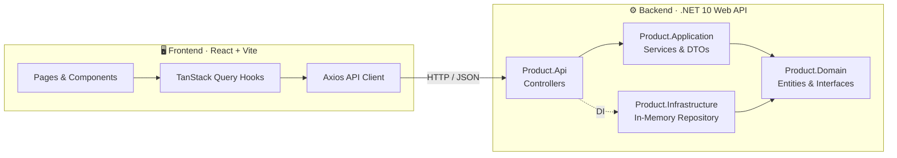

<div align="center">

# 🛍️ Product Management Monorepo

**A full-stack product management app with a React + TypeScript frontend and a .NET 10 Clean Architecture Web API.**

<p>
  
  
  
  
</p>
<p>
  
  
  
  
  
</p>

[✨ Features](#-features) •
[🏗️ Architecture](#️-architecture) •
[🚀 Getting Started](#-getting-started) •
[📡 API](#-api-reference) •
[📁 Structure](#-project-structure) •
[📄 License](#-license)

</div>

---

## 🎯 Purpose

> 🤖 **AI-first by design.** This monorepo is built on **predefined design patterns** that give LLMs a clear, predictable blueprint. When every feature and layer follows the same structure, AI assistants generate code that is **more accurate, consistent and maintainable**.

<table>
<tr>
<td width="50%" valign="top">

### 🎨 Frontend: Feature-Based Structure (FBS)

Each feature lives in its own folder under `src/features/<feature>/`:

```text
features/products/
├── components/   # UI for the feature
├── hooks/        # TanStack Query hooks
├── services/     # API calls
├── types/        # TypeScript types
├── utils/        # Zod validation & helpers
└── index.ts      # Public API of the feature
```

Shared building blocks live in `shared/`, and route-level screens in `pages/`.

</td>
<td width="50%" valign="top">

### ⚙️ Backend: Clean Architecture

Each layer has a single responsibility, and dependencies point **inward**:

```text
Product.Api            → Controllers, DI, Swagger
   ↓
Product.Application    → DTOs, services, interfaces
   ↓
Product.Domain         → Entities, repository contracts
   ↑
Product.Infrastructure → Repository implementations
```

The domain has **zero dependencies**, so business rules stay pure.

</td>
</tr>
</table>

| 💡 Why it matters for AI | |
|---|---|
| 🧭 **Predictable** | The LLM always knows where new code belongs |
| 🔁 **Repeatable** | New features copy an existing, proven pattern |
| 🧩 **Isolated** | Changes stay small and scoped to one feature or layer |
| ✅ **Reviewable** | Generated code is easy to verify against known conventions |

---

## ✨ Features

| | Feature | Description |
|---|---|---|
| 📦 | **Full CRUD** | Create, view, edit and delete products |
| ⚡ | **Fast UI** | Vite-powered React 19 app with instant HMR |
| 🎨 | **Modern components** | shadcn/ui-style components built on Radix UI + Tailwind CSS |
| 🔄 | **Smart data fetching** | TanStack Query for caching, loading states and mutations |
| ✅ | **Validation everywhere** | Zod + React Hook Form on the client, domain rules on the server |
| 🧅 | **Clean Architecture** | Domain, Application, Infrastructure and API layers in the backend |
| 📖 | **Interactive docs** | Swagger UI out of the box |
| 🧪 | **Zero setup storage** | In-memory repository seeded with test data — no database required |

---

## 🏗️ Architecture



### 🖥️ Frontend

React + TypeScript application built with Vite, organized with a **feature-based** folder structure.

- **Routing** — React Router 7 (`/products`, `/products/new`, `/products/:id`, `/products/:id/edit`)
- **State & data** — TanStack Query hooks (`useProducts`, `useCreateProduct`, `useUpdateProduct`, …)
- **Forms** — React Hook Form + Zod schemas
- **Styling** — Tailwind CSS 4, Radix UI primitives, Lucide icons

### ⚙️ Backend

.NET Web API following **Clean Architecture** principles.

| Layer | Project | Responsibility |
|---|---|---|
| 🌐 Presentation | `Product.Api` | Controllers, Swagger, CORS, DI setup |
| 🧠 Application | `Product.Application` | Services, DTOs, use-case interfaces |
| 💎 Domain | `Product.Domain` | `Product` aggregate, business rules, repository contracts |
| 🗄️ Infrastructure | `Product.Infrastructure` | In-memory repository & seed data |

**Domain rules include:** required product name, minimum price of `10`, stock management, activation/deactivation, and discounts capped at 50%.

---

## 🚀 Getting Started

### 📋 Prerequisites

| Tool | Version |
|---|---|
| 🟣 [.NET SDK](https://dotnet.microsoft.com/download) | 10.0+ |
| 🟢 [Node.js](https://nodejs.org/) | 20+ (or [Bun](https://bun.sh/)) |

### 1️⃣ Clone the repository

```bash
git clone https://github.com/mohsinjk/monorepo.git
cd monorepo
```

### 2️⃣ Install frontend dependencies

```bash
cd frontend
npm install
cd ..
```

### 3️⃣ Run everything

**Option A — one command (bash):**

```bash
./start.sh
```

**Option B — run each app separately:**

```bash
# Terminal 1 — backend
cd backend
dotnet run --project src/Product.Api/Product.Api.csproj

# Terminal 2 — frontend
cd frontend
npm run dev
```

### 🌍 Open in your browser

| Service | URL |
|---|---|
| 🖥️ Frontend | http://localhost:5173 |
| ⚙️ API | http://localhost:5000 |
| 📖 Swagger UI | http://localhost:5000/swagger |

> 💡 **Tip:** The frontend API base URL is configured in [`frontend/src/shared/api/config.ts`](frontend/src/shared/api/config.ts).

---

## 📡 API Reference

Base route: `/api/Products`

| Method | Endpoint | Description | Success |
|:---:|---|---|:---:|
|  | `/api/Products` | List all products | `200` |
|  | `/api/Products/{id}` | Get a product by ID | `200` |
|  | `/api/Products` | Create a product | `201` |
|  | `/api/Products/{id}` | Update a product | `200` |
|  | `/api/Products/{id}` | Delete a product | `204` |

Errors return `400` (validation), `404` (not found), `409` (business rule violation) or `500`.

<details>
<summary>📝 <b>Example request</b></summary>

```bash
curl -X POST http://localhost:5000/api/Products \
  -H "Content-Type: application/json" \
  -d '{ "name": "Mechanical Keyboard", "description": "RGB, hot-swappable", "price": 129.99 }'
```

</details>

---

## 📁 Project Structure

```text
monorepo/
├── 📂 backend/
│   ├── Product.slnx
│   └── src/
│       ├── Product.Api/              # 🌐 Controllers & startup
│       ├── Product.Application/      # 🧠 Services & DTOs
│       ├── Product.Domain/           # 💎 Entities & interfaces
│       └── Product.Infrastructure/   # 🗄️ In-memory repository
├── 📂 frontend/
│   └── src/
│       ├── app/                      # App root & router
│       ├── components/ui/            # Reusable UI components
│       ├── features/products/        # Product feature (components, hooks, services, types)
│       ├── layouts/                  # Page layouts
│       ├── pages/                    # Route pages
│       └── shared/                   # API client, shared components & utils
└── 🚀 start.sh                       # Starts backend + frontend together
```

---

## 🛠️ Available Scripts

| Location | Command | Description |
|---|---|---|
| `frontend/` | `npm run dev` | Start the Vite dev server |
| `frontend/` | `npm run build` | Type-check and build for production |
| `frontend/` | `npm run lint` | Run ESLint |
| `frontend/` | `npm run preview` | Preview the production build |
| `backend/` | `dotnet build` | Build the solution |
| `backend/` | `dotnet run --project src/Product.Api` | Run the API |

---

## 🤝 Contributing

Contributions are welcome! 🎉

1. 🍴 Fork the repository
2. 🌿 Create a feature branch: `git checkout -b feature/amazing-feature`
3. 💾 Commit your changes: `git commit -m "Add amazing feature"`
4. 📤 Push the branch: `git push origin feature/amazing-feature`
5. 🔃 Open a Pull Request

---

## 📄 License

This project is licensed under the [MIT License](LICENSE).

---

<div align="center">

Made with ❤️ using **React** and **.NET**

⭐ If you find this project useful, please give it a star!

</div>
